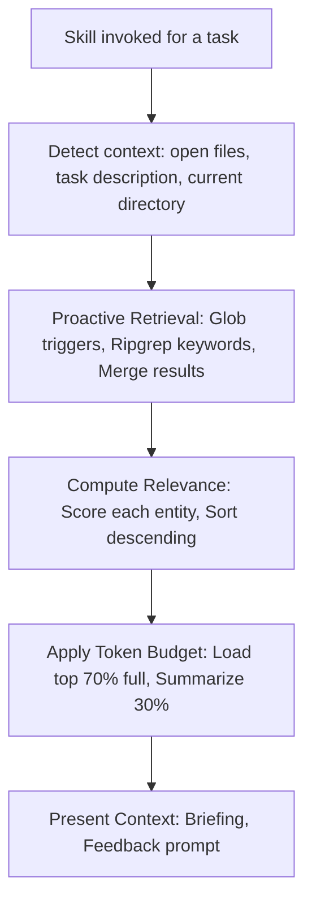
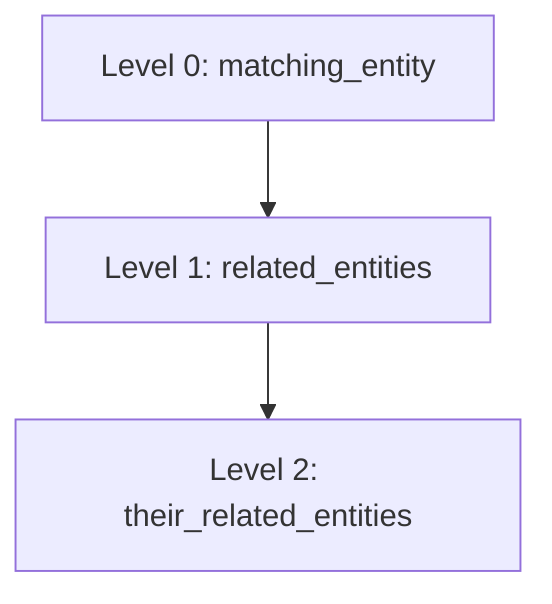

# QUERY Operation - Read from Knowledge Graph

## When to Use This Operation

- User says "load context for", "what do we know about", "check the graph"
- Agent starts work on a file that might have matching entities
- User asks about project architecture or entity relationships
- **AUTO-QUERY**: Triggered at session start (see Auto-Query section)

## When NOT to Use This Operation

- User wants to create/update entities (use ADD, UPDATE, or DELETE operation)
- Entity explicitly doesn't exist and user doesn't want to create it
- Information is available in current workspace (use Read directly)

## Critical Rules

### RULE 1: NO FABRICATION

> Only report information that exists in entity nodes. Quote verbatim, don't interpret.

### RULE 2: CITE SOURCES

> Always cite the entity document path when presenting information.

### RULE 3: STALE DETECTION

> Warn if entity references files that no longer exist.

### RULE 4: RESPECT TOKEN BUDGET

> Load context within budget. Prioritize high-relevance entities. Summarize overflow.

### RULE 5: QUERY IS READ-ONLY BY DEFAULT

> Loading context must not change the graph. Steps 9 and 10 below describe optional bookkeeping, and both are **skipped unless the user asks for them**:
>
> - Staleness findings are reported, not written. Use UPDATE if the user wants `health.*` persisted.
> - `usage.*` is only refreshed when the user says "track this query" (or equivalent), because it rewrites every loaded node.
>
> This keeps QUERY safe to run proactively: a read that silently rewrites twenty files is a surprise, and it makes the whole graph dirty before the user has decided anything. If bookkeeping is requested, it is a write and follows RULE 3 of SKILL.md (confirm before writing).

## Workflow

### Step 1: Resolve Paths

Resolve `{vault}`, `{memory}` and `{project}`:

If ambiguous, enforce [Critical Rule 1](../../SKILL.md#rule-1-resolve-paths-once)

Set `{graph_path}` = `{vault}/{memory}/{project}/`

### Step 2: Identify Query Type

| Query Type      | Example                                  | Action                                       |
| --------------- | ---------------------------------------- | -------------------------------------------- |
| **File match**  | Agent working on `src/auth/service.py`   | Find entities with matching trigger patterns |
| **Entity name** | "Load context for {project}.auth-module" | Load specific entity by name                 |
| **Search**      | "What entities relate to auth?"          | Grep for patterns                            |
| **Explore**     | "Show me the knowledge graph"            | Load {project}.index.md or list entities     |
| **Auto-query**  | Session start                            | Proactive context loading (see below)        |

### Step 3: Find Matching Entities

#### File Match (Auto-load)

Match against the `triggers` list inside each node's `agent-context` block. Read the block, then compare the current file path with each `pattern` in-process - do not grep a pattern built from a file path, since a path containing regex metacharacters would change the query.

```
Glob(pattern: "{graph_path}/entities/*.md")
Read each → parse agent-context triggers → match against the current file path
```

#### Entity Name

Validate `{project}` and `{entity-name}` per [safe-paths.md](../helpers/safe-paths.md) before building the path (same check as ADD/UPDATE Step 1). Then:

```
Read("{graph_path}/entities/{project}.{entity-name}.md")
```

An unsafe or non-existent name is reported, never passed to a shell command.

#### Search

Search for the user's term as **plain text**, not as a regex. `{search_term}` comes from a user message and may contain any character.

```shell
# Fixed-string (literal) search: the term is data, never a pattern
rg -l -F -i --glob "*.md" -- "{search_term}" "{graph_path}"
```

If the Grep tool is used instead, pass it in literal/fixed-string mode (`fixed_strings: true`), or escape the term before use. Never interpolate `{search_term}` into a regex raw: `(`, `[`, `*` and `\` either change the match or fail outright.

**Scope:** `{graph_path}` is a validated, quoted, single path component chain. Never widen a search to the vault root or to `$HOME`.

#### Proactive Retrieval (Auto-Query)

For auto-query, do this before reading any helper:

1. Extract keywords from the current context (task, open files) - split on path separators, camelCase, and hyphens
2. Run a fixed-string ripgrep search if available (see [Ripgrep Search](#ripgrep-search))
3. Match results to entity triggers
4. Merge with glob-based results

Only read [keyword-extraction.md](../helpers/keyword-extraction.md) if the task needs more than that.

**Load budget for QUERY:** read `ops/QUERY.md` + `helpers/safe-paths.md` first (path safety is not optional), then at most one helper when a step says you need it. A plain "what do we know about X" should never open four helpers before it opens an entity.

### Step 4: Compute Relevance Scores

The formula is below; you do **not** need to load a helper to apply it. Read [relevance-scoring.md](../helpers/relevance-scoring.md) only if you want the worked examples or the reference implementation.

For each matching entity:

1. Gather metadata: importance, usage
2. Compute `importance_weight` (high=1.0, medium=0.7, low=0.4)
3. Compute `recency_factor = 1 / (1 + days_since_last_used / 30)`
4. Compute `usage_factor = log(use_count + 1) / log(max_use_count + 1)`
5. Calculate `relevance = importance_weight × recency_factor × usage_factor`

### Step 5: Parse Entity Document

For each matching entity:

1. Extract frontmatter (between `---` delimiters)
2. Parse `agent-context` code block (YAML)
3. Extract wiki-links from `related` field

**Error handling:** If frontmatter is malformed (missing `---`, invalid YAML):

- Log: "Malformed frontmatter in [[{project}.{entity}]]: {error}"
- Skip parsing for this entity
- Continue with remaining entities
- Note in report: "Skipped {project}.{entity} - malformed frontmatter"

### Step 6: Traverse Related Entities

Read [graph-traversal.md](../helpers/graph-traversal.md) only for the cycle-handling rules when the graph is dense. The default is simple:

1. For each wiki-link in `related`, load that entity
2. Default depth: 2 levels - **stop at depth 2**; deeper traversal is opt-in ("with depth 3")
3. Keep a visited set so a cycle cannot loop forever
4. Compute relevance scores for traversed entities

### Step 7: Apply Token Budget

Read [token-budget.md](../helpers/token-budget.md) only when you need exact counting heuristics. The rule is: **load less, earlier**.

1. Estimate tokens for all loaded entities (a rough `chars / 4` is fine)
2. If total exceeds budget:
   - Sort entities by relevance (descending)
   - Load top 70% budget as full detail
   - Load remaining 30% budget as summaries
   - Omit overflow with count

### Step 8: Present Context Briefing

This is the **single canonical output format** for a successful QUERY. Do not invent a second report.

```
### QUERY Complete

**Matched:** {count} entities
**Loaded:** {loaded} full, {compressed_count} summarized, {omitted_count} omitted
**Tokens:** {tokens}/{budget}
**Traversed:** {levels} levels
**Sources:** {graph_path}

---

#### [[{project}.{entity-1}]] (relevance: 0.92)

**Type:** {type} | **Category:** {category} | **Importance:** {importance}
**Last updated:** {updated}

##### Constraints (MUST follow)
1. {constraint_1}
2. {constraint_2}

##### Patterns (SHOULD use)
**{pattern_name}:** {pattern_template}

##### Checks to Run After Changes
- {check_1}
- {check_2}

##### Related Entities
- [[{project}.related-1]] — {brief description}
- [[{project}.related-2]] — {brief description}

##### Implementation Files
- `{file_1}` — {description}
- `{file_2}` — {description}

---

#### [[{project}.{entity-2}]] (relevance: 0.78) — *Summary*

- Type: {type} ({category})
- Key constraint: {most_important_constraint}
- Related: [[{project}.related-1]], [[{project}.related-2]]

---

*{omitted_count} lower-relevance entities omitted. Use "load full context for {name}" to see all.*

Every entity above is cited by its document path (RULE 2). Content is quoted verbatim (RULE 1).
```

### Step 9: Stale Entity Check (report only)

**Do not write.** Report what you find; persisting `health.*` is an UPDATE operation.

For each implementation file listed:

1. Check existence with the read-only file tools, **never** by interpolating the stored path into a shell command. `implementation_files` entries come from node content, which RULE 10 treats as untrusted; a path like `x; rm -rf ~` must not reach a shell. Use `Glob` with the literal path, or a filesystem existence check, and treat a parse error as "unknown".

   ```
   Glob(pattern: "{implementation_file}")   # literal path, no shell involved
   ```

2. If not found:
   - Warn: "⚠ [[{project}.{entity}]] may be stale: {file} not found"
   - Offer: "Mark this entity `needs_update`? [Yes] [No]" - only on yes does STEP 10b below run
   - Never update the file as part of a plain read

**Error handling:** If the existence check fails (permissions, malformed path):

- Log: "Cannot check file existence: {error}" (report the path quoted, never execute it)
- Mark file as "unknown status" rather than stale
- Warn: "⚠ Cannot verify [[{project}.{entity}]] implementation file"

### Step 10: Usage Metadata (opt-in)

**Skip by default.** Run this only when the user asks to track the query, because it rewrites every loaded entity.

When requested, for each entity loaded (full or summarized), propose the change and confirm before writing:

```yaml
usage:
  last_used: {today}
  use_count: {previous_count + 1}
```

Present one confirmation covering the batch ("Update usage on 4 entities? [Yes] [No]"), then write. If the graph is in version control, say so - the diff will be noisy.

### Step 10b: Persist Stale Flags (opt-in)

Only after the user answers *Yes* in Step 9. Re-serialize the frontmatter through UPDATE (never hand-edit): set `health.stale_files` and `health.needs_update`, and add a changelog entry noting the staleness check.

## Auto-Query

Auto-query runs when the skill is invoked for a task. It is a first step, not a hook.

### Auto-Query Flow



**Auto-query is opportunistic, not automatic.** A skill cannot hook "session start": it only runs when the description matches or the user invokes it. So treat this as "run QUERY once at the start of *this* invocation, before the real work", not as a background process. If the user's first message is not about the codebase (small talk, an unrelated question), skip it.

### Skip/Disable Auto-Query

The user can decline for the session ("skip auto-query") or turn it off. Keep that preference **in the conversation**, not on disk:

- Skip: drop the context load for the current invocation and continue
- Disable: stop offering it for the rest of the session; re-enable if the user asks

Do **not** write `{graph_path}/.auto-query-config` (or any dotfile) into the graph. It is not a node, it breaks VERIFY CHECK 9 (unexpected root artifact), and it pollutes a directory a human browses. If a durable preference is genuinely needed, ask the user to put it in their global agent config instead.

## Proactive Retrieval

### Keyword Extraction

Use [keyword-extraction.md](../helpers/keyword-extraction.md):

1. **From triggers**: Extract path components (`src/auth/service.py` → `auth`, `service`)
2. **From tags**: Use entity tags directly
3. **From task**: Extract keywords from task description (if available)

### Ripgrep Search

If ripgrep is available, search the codebase with the extracted keywords. Keywords are derived from node content and file paths, so build the alternation from escaped words (or pass them as repeated fixed-string patterns) and never paste free text in:

```shell
# keywords come from validated extraction; each is a fixed string
rg -l -F -i -e "auth" -e "service" -e "middleware" -- "{codebase}"
```

There is no `--type code` type in ripgrep (`rg: unrecognized file type: code`). Either omit `--type` or use a real type such as `--type py` / `--type ts`.

Timeout: 5 seconds.

### Merge Results

1. Match ripgrep results to entity triggers
2. Merge with glob-based matches
3. Dedupe by entity name

## Graph Traversal

### Default Traversal (2 levels)



### Controlled Traversal

```
User: "Load context for {project}.auth-module with depth 3"
```

Traverse 3 levels deep, presenting all constraints and patterns.

## Missing Entity Handling

### Entity Not Found

```
No entity found matching: {query}

Would you like to:
1. Create a new entity
2. Search for similar entities
3. Continue without context
```

### Partial Match

```
No exact match for "{query}". Similar entities:
- [[{project}.auth-module]] — Authentication module
- [[{project}.auth-middleware]] — Request auth middleware

Select one or create new?
```

## Output Format

There is **one** success format: [Step 8](#step-8-present-context-briefing). Earlier drafts had a second "Successful Load" block with different field names; it was removed so an agent cannot report the same result two ways.

After the briefing, ask once whether the context was useful - it is the signal that makes relevance scoring improve:

```
**Was this context helpful?** [Yes] [Partially] [No]
```

### No Match

```
### QUERY Result: No Match

Searched for: {query}
Path: {graph_path}

Suggestions:
- Check if vault path is correct
- Create the entity with ADD/UPDATE/DELETE operation
- Try broader search terms
```

## Mermaid Visualization Offer

After presenting query results, offer to generate a Mermaid diagram:

```
**Generate Mermaid diagram of these results?** [Yes] [No]
```

If user accepts:

1. Read [../mermaid/ops/ADD.md](../mermaid/ops/ADD.md) for generation workflow
2. Ask user which [template](../mermaid/templates) to use
3. Generate diagram and write to `{graph_path}/{query}-diagram.md`

## Best Practices

- Scope searches to relevant folders
- Parse frontmatter before reading full content
- For large graphs, use targeted grep instead of glob
- Always cite entity paths when presenting information
- Warn about stale entities but don't auto-fix (use ADD/UPDATE)
- Compute relevance before loading to prioritize
- Respect token budget to avoid context explosion

## Reusing Results Within a Turn

There is no persistent query cache. An agent has no process to hold one between turns, so "cache with a 5-minute TTL" is fiction - and the pseudo-code it used to contain did not even parse.

What does help:

- **Within one turn**, load an entity once and reuse it rather than re-reading the same path for each follow-up question.
- **Across turns**, just run QUERY again. It is a few small file reads; the token budget already limits how much is loaded.
- If the user says "fresh" or "reload", ignore anything already in context and re-read from disk.

If you need the same context repeatedly in a long session, say so in the briefing ("loaded 6 entities") so the user can see what is already in context.

---

## See Also

**Related Operations:**

- [ADD](./ADD.md) - Create new entities
- [UPDATE](./UPDATE.md) - Modify existing entities
- [DELETE](./DELETE.md) - Remove entities
- [RENAME](./RENAME.md) - Rename/move entities

**Related Assets:**

- [graph-traversal.md](../helpers/graph-traversal.md) - Traverse related entities
- [relevance-scoring.md](../helpers/relevance-scoring.md) - Compute relevance scores
- [token-budget.md](../helpers/token-budget.md) - Manage token budget
